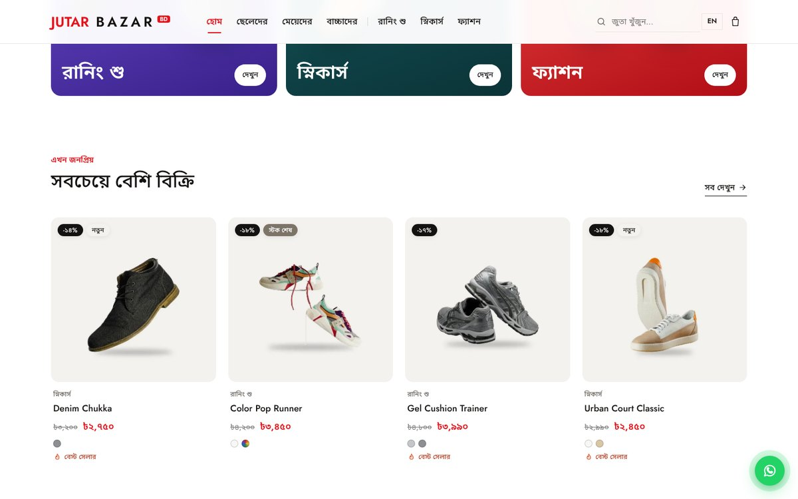
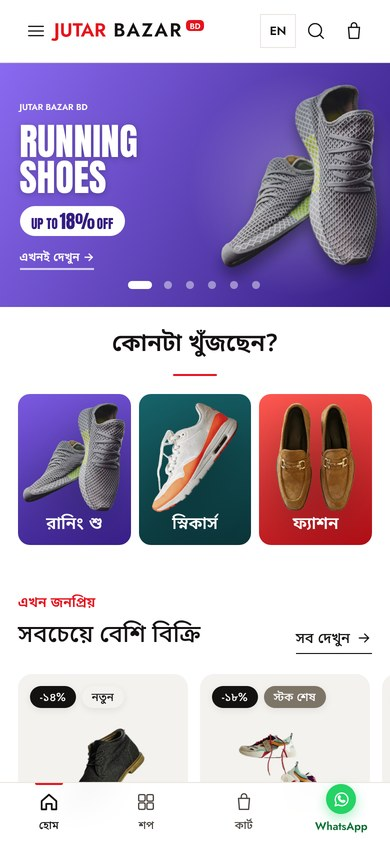
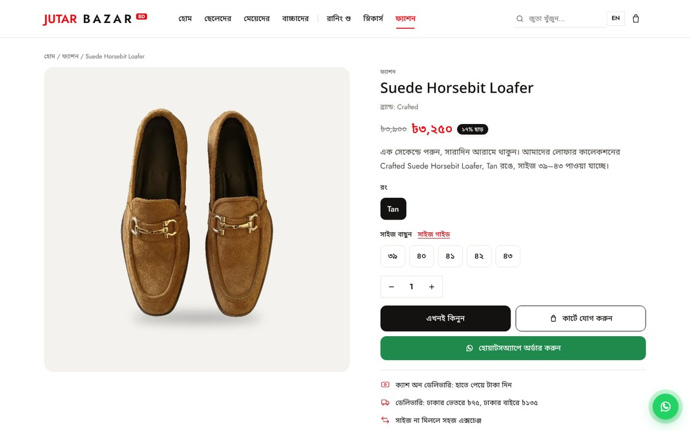
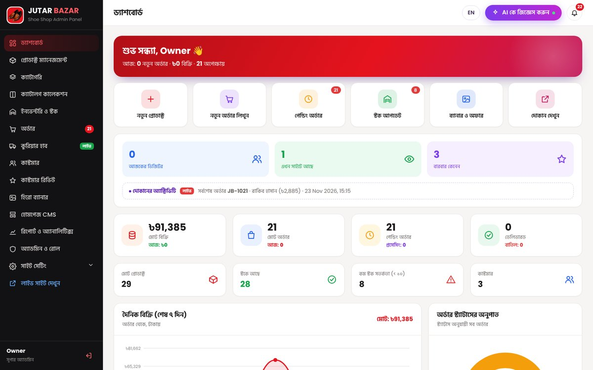
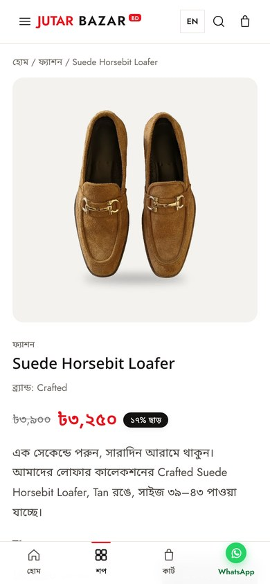
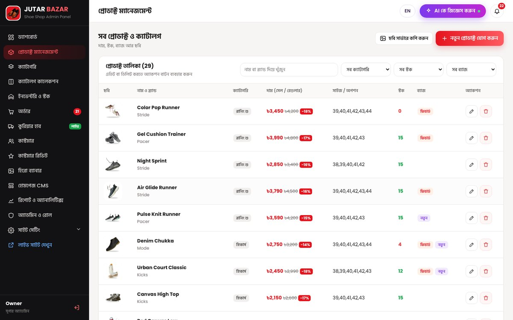

  

<h1 align="center">জুতার বাজার বিডি · JUTAR BAZAR BD</h1>

  <b>Bangla-first online shoe shop for Bangladesh, with a Bangla admin panel and AI auto captions.</b> 
  PHP 8 + SQLite: upload, extract, done. No database setup.

  <a href="https://abid2929.github.io/JUTAR-BAZAR/"><b>👀 Live demo</b></a> &nbsp;·&nbsp;
  <a href="https://abid2929.github.io/JUTAR-BAZAR/admin/"><b>🔐 Admin demo</b></a>

     

  <kbd>PHP 8</kbd> <kbd>SQLite</kbd> <kbd>JavaScript</kbd> <kbd>CSS3</kbd> <kbd>Google Gemini</kbd> <kbd>Facebook Pixel</kbd> <kbd>GA4</kbd> <kbd>Bangla + English</kbd>

> The demo is a static preview, so nothing is saved. The admin demo opens **without a password** and shows **sample data only**.

---

## 📸 Screenshots

<table>
  <tr>
    <td width="68%"> Product cards: price, discount, colours and stock at a glance</td>
    <td width="32%" rowspan="2"> Phone: offer slider, colourful category tiles, app-style tab bar</td>
  </tr>
  <tr>
    <td> Product page: pick a size, buy now, add to cart or order on WhatsApp</td>
  </tr>
  <tr>
    <td> Admin dashboard (Bangla): today's orders, sales, visitors, low stock</td>
    <td rowspan="2"> Phone product page</td>
  </tr>
  <tr>
    <td> Products: photos, prices, sizes, colours and stock in one place</td>
  </tr>
</table>

---

## ✨ What's inside

**Storefront (opens in বাংলা, one tap to English)**
- Real shop info: JUTAR BAZAR BD, call 01624-244920, WhatsApp 01608-565035, Facebook page, Dhaka address (opposite Jamuna Future Park). All editable in Settings.
- Offer banner slider at the top. Every collection page opens on its own banner.
- **Men / Women / Kids** sections, plus 3 categories: Running, Sneakers, Fashion.
- Product pages with a size guide, an "only X left" badge, related products and recently viewed.
- Cart, checkout with cash on delivery (plus bKash / Nagad with TrxID when turned on), order tracking, WhatsApp ordering and a WhatsApp popup.
- A calm, premium first screen: soft entrance animation, no top bar, the WhatsApp popup waits until the visitor scrolls.
- Phone layout that feels like an app: one-line header and a bottom tab bar (Home, Shop, Cart, WhatsApp).
- Fast: phone-sized photo copies, lazy loading and clean HTML. SEO-ready: meta tags, canonical, JSON-LD and sitemap.xml.

**Admin panel (the same admin as the owner's other shops, Bangla with an English button)**
- Dashboard: today's numbers, quick buttons, visitors today and browsing now, 7-day sales chart, order status donut. App-style bottom bar on phone.
- Products with sizes (tap 36-46 or kids sizes), colours, a photo gallery with a colour tag per photo, stock, flash sale / new / best seller badges.
- **AI copywriter:** English + Bangla description, Facebook post and tags in 5 tones. Free with a Google Gemini key, or built-in templates.
- Categories, catalog collections (own row on the homepage), inventory, customer reviews, hero banner slides, homepage CMS.
- Orders with status history, invoice print, manual orders, CSV export, Steadfast courier hub, customers, reports.
- Admins & roles (super admin, manager, staff), 8 settings tabs (store, delivery, payment, courier, SMS, Meta Pixel + Conversions API, Google SEO, password & backup).

## 🚀 Install on cPanel (about 5 minutes)

1. Download this repo as a ZIP (**Code → Download ZIP**).
2. Upload everything **except the `docs/` folder** to `public_html`, then extract it.
3. Open `yourdomain.com/admin` and set your admin password on the first visit. After that you sign in with **just the password**. Staff tap "Staff? Sign in with username".
   Forgot it? Create an empty file `reset-admin.txt` in `public_html`, open `/admin` and set a new one. Your products and orders stay.
4. Change the shop name, phone, WhatsApp number and delivery charges in **Settings**.

Needs PHP 8.0 or newer with SQLite (standard on cPanel hosting).

## 📁 Folder map

| Folder | What it is |
|---|---|
| `index.php`, `inc/` | Storefront and core code |
| `admin/` | Admin panel |
| `assets/` | CSS, JS, images (`demo/*/s/` = phone-size copies) |
| `data/`, `uploads/` | Created on the server: database and uploaded photos (protected, not in this repo) |
| `docs/` | Static demo for GitHub Pages only. Do not upload it to the server. |

## 🕒 Latest updates

| Version | What changed |
|---|---|
| 2.6.2 | Top bar removed, smooth first-screen entrance, WhatsApp popup waits for scroll |
| 2.6.1 | Admin sign-in with the password only, eye button on every password field |
| 2.6.0 | Premium store look: studio photo tiles, rounded cards, trust cards, payment chips |
| 2.5.0 | New shared admin panel, reviews, collections, bKash/Nagad with TrxID, visitor counter |

## 📝 Notes

- Demo product photos are free-licence photos (Unsplash) with brand logos removed. Replace them with your own shop photos from the admin panel.
- No passwords, API keys or customer data are stored in this repo.

---

  Designed &amp; developed by <a href="https://github.com/abid2929"><b>Abid Islam</b></a> &amp; <a href="https://boostnixmedia.com/">Boostnix Media</a>

